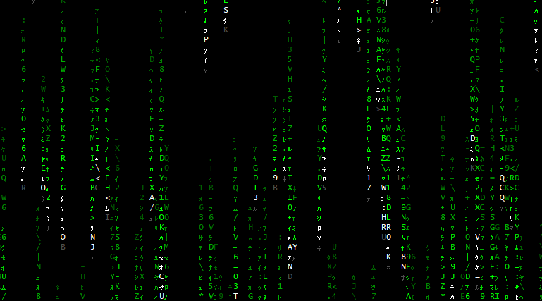

# cmatrix-py

<p>
  
</p>

A terminal-based **"digital rain"** effect inspired by *The Matrix*, written in pure Python with `curses`. Zero third-party dependencies.


---

## Features

- Authentic falling characters: katakana, digits, letters, and symbols
- Smooth fade from bright head to dark tail (6 levels of green in 256-color mode)
- Independent columns with randomized speed and trail length
- Live controls: pause, adjust speed, exit
- Color themes: green, red, blue, cyan, magenta, yellow, white
- Auto-resizes with the terminal window
- No dependencies — just Python and `curses`

---

## Requirements

- **Python 3.8+**
- A terminal with `curses` support:
  - Linux / macOS — works out of the box
  - Windows — use **Windows Terminal** (legacy `cmd.exe` is not supported)
- For best visuals: a terminal with **256-color** support

---

## Installation

Clone the repository:

```bash
git clone https://github.com/<your-username>/cmatrix-py.git
cd cmatrix-py
```

Make it executable (optional):

```bash
chmod +x cmatrix.py
```

---

## Usage

```bash
python3 cmatrix.py
```

### Command-line options

| Option | Description | Default |
|---|---|---|
| `-c`, `--color` | Rain color: `green`, `red`, `blue`, `cyan`, `magenta`, `yellow`, `white` | `green` |
| `-s`, `--speed` | Base speed (lower = faster) | `4` |
| `-f`, `--fps` | Frames per second | `60` |

### Examples

```bash
# Classic green rain
python3 cmatrix.py

# Fast red rain
python3 cmatrix.py -c red -s 2

# Light on CPU
python3 cmatrix.py -f 30

# Blue, slow, cinematic
python3 cmatrix.py -c blue -s 6 -f 45
```

---

## Controls

| Key | Action |
|---|---|
| `q` / `Esc` | Quit |
| `Space` | Pause / resume |
| `+` / `=` | Increase speed |
| `-` / `_` | Decrease speed |

---

## How it works

Each column on the screen is an independent `Column` object with its own:

- **head position** — the leading bright character
- **trail length** — how many characters fade behind the head
- **speed** — how many frames to wait between steps
- **character buffer** — a `dict` of `y → char`

Every frame:

1. Each column advances its head by one cell (respecting its speed).
2. A random symbol is placed at the new head position.
3. Characters beyond the trail are removed.
4. Each visible cell is drawn with a color from the brightness palette, based on its distance from the head.

The head itself is drawn in **bold white**, the tail gradually darkens toward the background.

---

## Color palette (256-color mode)

The green theme uses the following curses color indexes:

| Position | Color index | Appearance |
|---|---|---|
| Head | `231` | bright white (bold) |
| — | `46` | bright green |
| — | `40` | green |
| — | `34` | medium green |
| — | `28` | dark green |
| Tail | `22` | very dark green |

For non-green themes or terminals without 256-color support, a simpler two-tone palette is used (white head + solid color tail).

---

## Project structure

```
cmatrix-py/
├── cmatrix.py     # single-file implementation
└── README.md
```

---

## License

MIT License. See [LICENSE](LICENSE) for details.

---

## Acknowledgments

Inspired by the original [`cmatrix`](https://github.com/abishekvashok/cmatrix) by Abishek V Ashok and the visual style of *The Matrix* (1999).
